# GarageDesk

**A simple workshop manager for small car service shops: customers, cars, job cards, service history, WhatsApp reminders and printable invoices.** Built with ASP.NET Core, in English and Arabic.

[](https://github.com/YoussefMDarweesh/garagedesk/actions/workflows/ci.yml)
[](LICENSE)

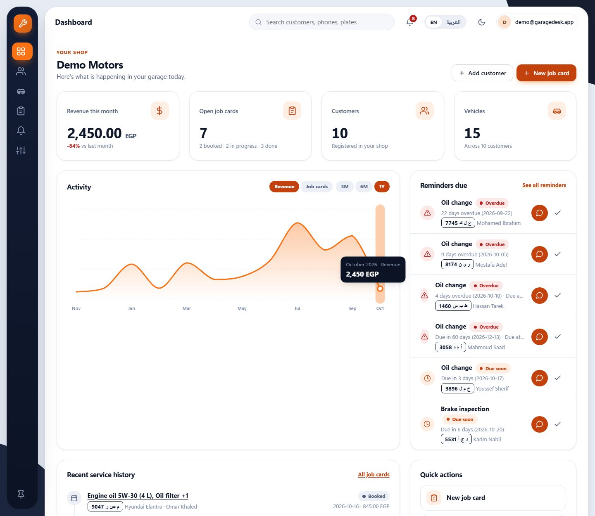

> **Status:** all eight milestones are built and tested, and the app is **deployment-ready but not deployed**: there is no live site. You run it locally in a few minutes ([how](#run-it-locally)). The host is chosen (MonsterASP.NET's free plan) and the deploy guide is in the repo ([details](#deployment)).
>
> **Demo video:** _coming soon (link goes here)_

## Why
Small car service shops in Egypt run on paper, WhatsApp chats, and Excel. Service history gets lost, customers don't get reminded about their next oil change, and invoices are handwritten. GarageDesk gives a shop owner one place for all of it, free and simple.

I run an automotive software business and manage a fleet of cars, so I've been on both sides of the counter. This project is my answer to the problems I see every week.

## What it looks like

All of these come from the seeded demo shop, "Demo Motors" (see [Run it locally](#run-it-locally)), except where noted.

| | |
|---|---|
| 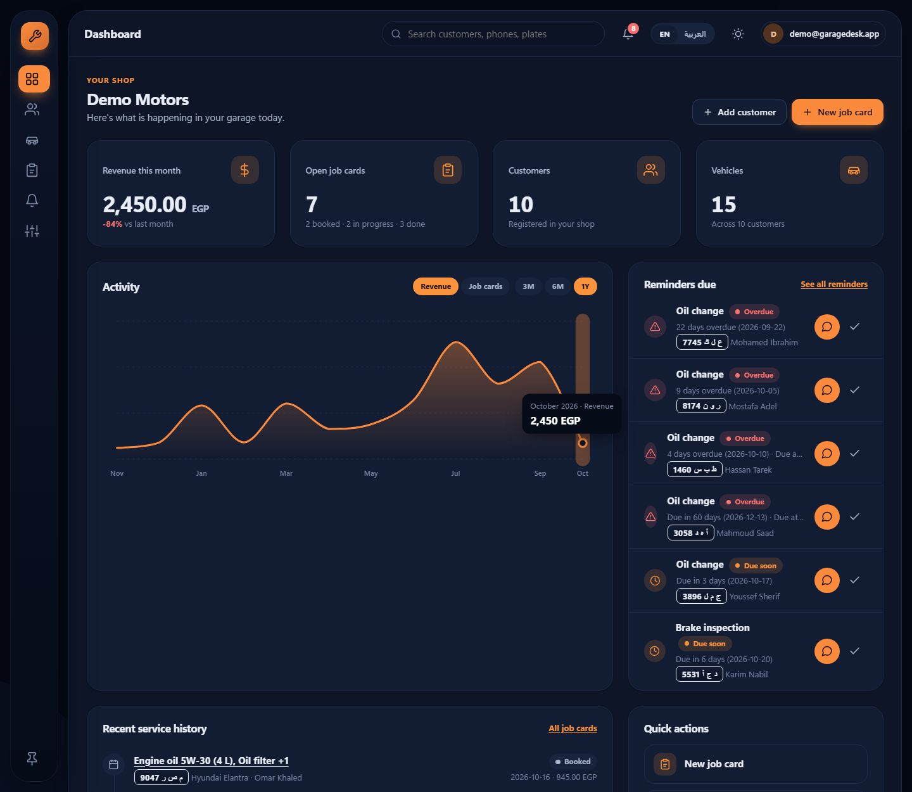 **Dashboard, dark mode.** One toggle, remembered per browser, no flash on load. | 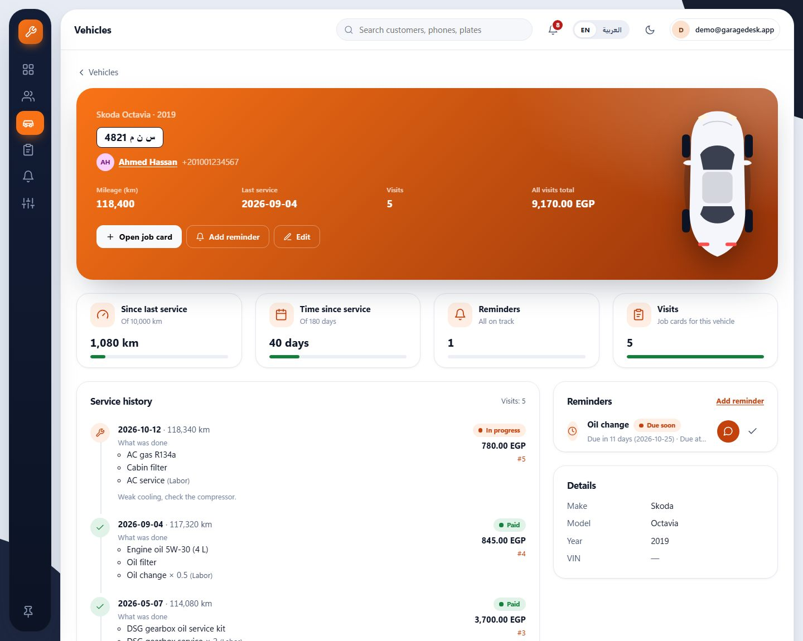 **A vehicle.** Kilometres and days since the last service, reminders, and every past visit, newest first. |
| 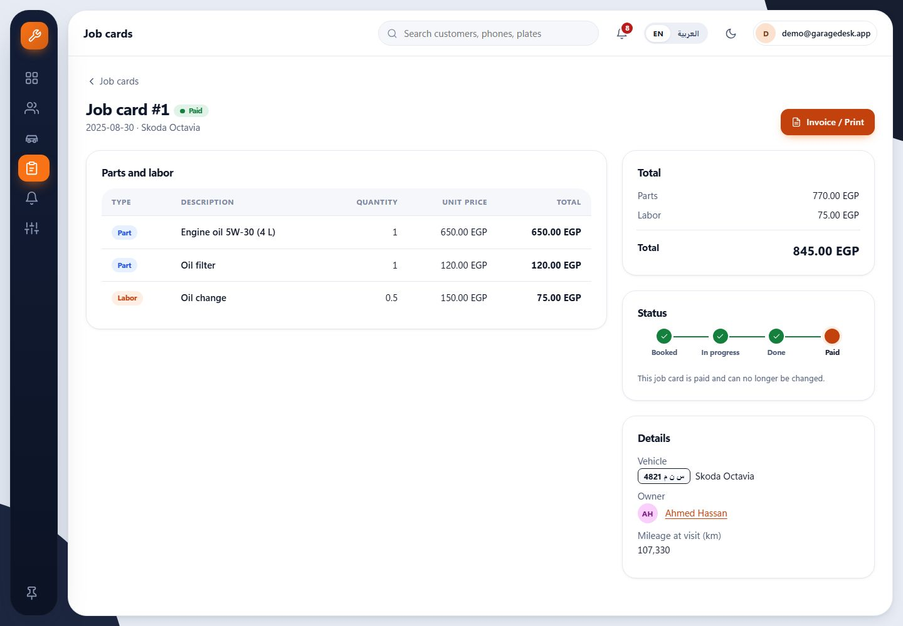 **A job card.** Parts and labor, totals worked out for you, and a status flow from Booked to Paid. | 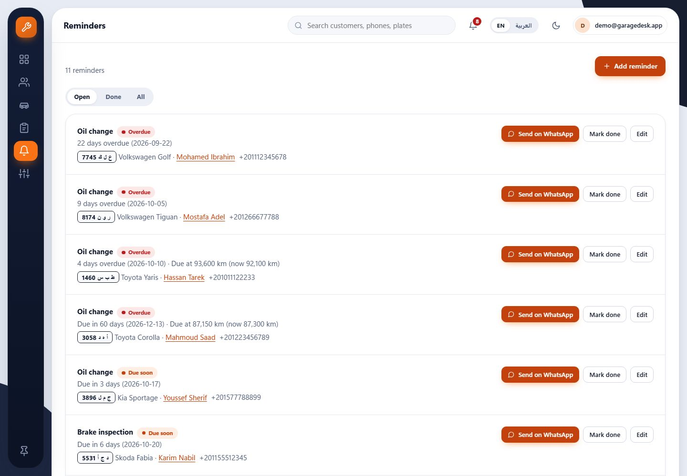 **Reminders.** Overdue and due-soon, each with a one-tap WhatsApp message. |
| 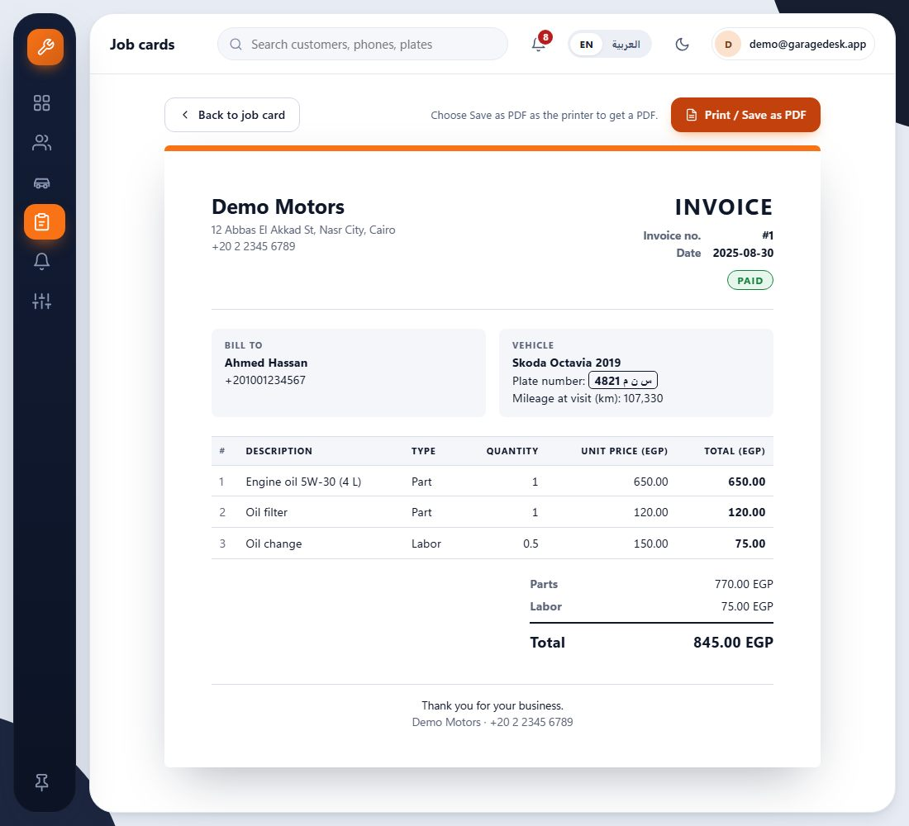 **The invoice on screen.** Print it, or choose "Save as PDF" in the print dialog. | 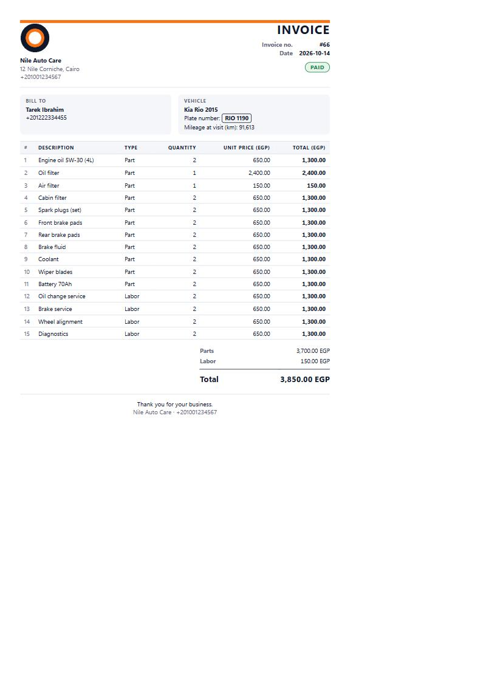 **The invoice, print layout.** A 15-line job fits one A4 page (shown from an earlier sample shop). |
| 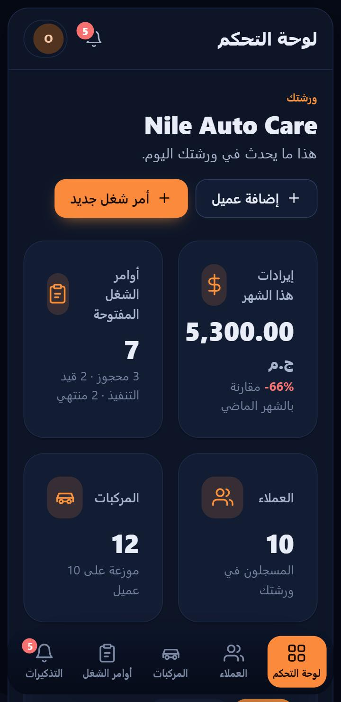 **Arabic on a phone.** Right-to-left, translated, with a bottom tab bar (earlier sample shop). | 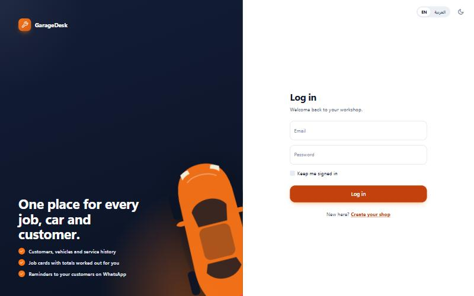 **Sign in.** Registering a new owner then asks for the shop's details. |

## Features
- **Shop accounts and multi-tenancy:** every shop is its own tenant. One shop can never see, change or guess another shop's data.
- **Customers and vehicles:** search by name, phone or plate. Egyptian phone numbers are normalized to `+20…`; plates are matched whether typed in Arabic or Latin letters, with or without spaces.
- **Job cards:** parts and labor lines, totals calculated automatically, and a status flow Booked → In progress → Done → Paid. A paid job card is final and locked.
- **Service history:** every visit for a car, newest first, with date, mileage, what was done and the total.
- **Reminders:** by date, by mileage, or both. Overdue and due-soon ones show on the dashboard and in a bell in the top bar, each with a **Send on WhatsApp** button that opens a pre-filled message (no paid API).
- **Printable invoices:** one clean A4 page per job card, in EGP, in English or Arabic. No PDF library: the browser prints or saves it.
- **Share links (WhatsApp-first):** send a customer a private link; they open it with no login and see their invoice, estimate or car status. Links are secret, expire, can be revoked and show only the minimum. Threat model: [docs/SECURITY_SHARE_LINKS.md](docs/SECURITY_SHARE_LINKS.md).
- **Parts and stock (v1.4):** a parts catalog (name, SKU, unit, cost, sell price, low-stock alert, supplier). Picking a part on a job card, an estimate or the technician page takes it from stock; taking the line off puts it back. Every change is an append-only stock movement, so the quantity is always explainable; the running-low list and a dashboard card tell you what to reorder.
- **Expenses, profit and the daily cash close (v1.4, owner only):** expenses by editable category; monthly profit on a **cash basis** (payments received minus expenses paid) and profit per job (revenue before VAT minus the cost of the catalog parts used); a daily close that works out the cash that should be in the drawer, takes your count and saves the difference as a record that cannot be changed.
- **CSV export (v1.4, owner only):** payments, expenses and job cards for a date range, as a UTF-8 file with a byte order mark so Excel shows Arabic correctly. Cells that could be read as a formula are defused.
- **English and Arabic (right to left)** and **light and dark** themes.
- **Shop logo and accent colour** from a settings page, shown in the navigation and on invoices.
- **Dashboard** with real numbers only: customers, vehicles, open job cards, revenue this month, a monthly activity chart and the latest service history.
- **Demo seeder:** one command creates the shop "Demo Motors" with 10 customers, 15 cars and a year of history.
- **My team (v1.3):** staff accounts with three roles. The *owner* sees everything; the *cashier* handles customers, job cards, payments, invoices and estimates but not settings, staff or reports; the *technician* sees only the job cards assigned to them and never a price, total, payment or customer phone number. Owners invite people with a one-time link, deactivate them, assign job cards, set a commission percent per person, and read a monthly commissions report and each job card's history. See [docs/ROLES.md](docs/ROLES.md).
- **Money (v1.1):** per-shop invoice and estimate numbers, partial payments with a balance per job card, a "who owes me" page, discounts, optional VAT, and estimates that convert into job cards.
- **Setup wizard and checklist (growth):** a new owner is guided through logo and colour, the first customer and car, and the first job card. The dashboard checklist is worked out from the shop's real data, so it ticks itself and survives a refresh.
- **CSV import (growth):** bring customers and cars from Excel or Google Sheets (saved as CSV UTF-8, comma or semicolon). A template in English or Arabic, a preview with per-row errors and duplicate detection, then one all-or-nothing import. Uploading the same file twice adds nothing.
- **Installable app (growth):** add GarageDesk to a phone's home screen. The service worker caches static files only, never pages. See [docs/PWA.md](docs/PWA.md).
- **Public landing page (growth):** logged-out visitors see what GarageDesk does, in English or Arabic, with screenshots, sign-in and sign-up links and an optional WhatsApp contact button. It shows nothing about any shop.

## How it works

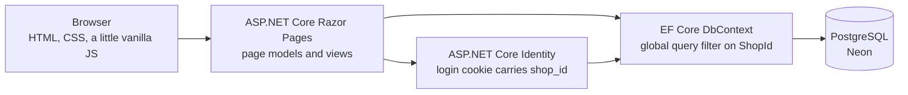

One web project, server-rendered pages, no frontend framework and no build step. Page models use the `DbContext` directly: at this size a repository layer would only add code.

### The multi-tenancy rule

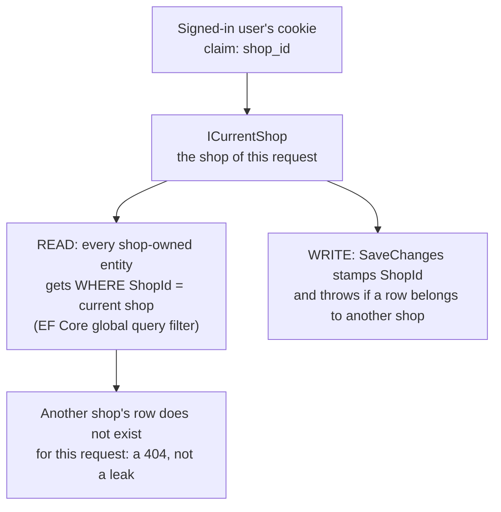

Shop-owned entities implement one marker interface (`IShopOwned`). The `DbContext` finds every type that implements it and applies the same filter, so a new entity is protected by writing `: IShopOwned`. The filter fails closed: with no shop, it matches nothing.

## Key engineering decisions
- **Tenant isolation is enforced and tested, not assumed.** The global query filter covers reads, a write guard covers saves, and every shop-owned entity has an isolation test: shop B asking for shop A's id gets a 404, and an attempt to write across shops throws.
- **Money.** `decimal`, never floating point. A line total is `quantity × unit price` rounded to the piastre (half away from zero, like a printed invoice). Job totals are worked out from the lines and never stored, so the job card and the invoice cannot disagree (they share the same code, and a test compares them).
- **Stock is a ledger, and cost is the owner's.** A part's quantity only changes together with a stock movement (opening, purchase, used on a job card, put back, correction), in the same save, and movements can never be edited or deleted. Two people changing the same quantity at once cannot overwrite each other. The cost of a part is copied onto the job line when it is added, so a later price change never rewrites old profit. Cost, stock value, profit, expenses, cash close and export are owner-only; a cashier sees sell prices and quantities, a technician sees names and quantities and no money at all.
- **Profit definitions are written down.** Monthly profit (cash basis) = payments received in the month, by the day received, minus expenses paid in the month. Payments include VAT where the shop charges it. Job profit = subtotal minus discount (before VAT) minus the recorded cost of catalog parts; labor has no cost and free-text parts have no known cost (the page says so). Expected cash in the drawer = cash already there at the start + cash payments - expenses paid from the drawer.
- **Mileage only goes up.** A job card's odometer reading raises the vehicle's current mileage when it is higher. An older or mistyped lower reading never winds it back.
- **Reminders.** A reminder is overdue once its date has passed or the vehicle's mileage is past the due mileage; due soon within 14 days or 500 km. With both, whichever comes first counts. Marking a job card Done offers the next oil change (6 months and +10,000 km, editable).
- **Localization with one `.resx` table.** The English text is the key, Arabic is `SharedResource.ar.resx`. A test scans the source for every translatable string and fails if one has no Arabic. RTL comes from CSS logical properties only (a test fails if a physical `left` or `right` sneaks in); phone numbers, VINs and amounts stay left-to-right inside Arabic text.
- **Print CSS as a feature, not an afterthought.** The invoice has its own paper palette, hides the app chrome, repeats the table header across pages and never splits a row or the totals. Tests assert those rules; see the limits below for what was and wasn't verified.
- **The logo lives in the database, validated by its bytes.** PNG, JPEG or WebP up to 512 KB, recognized by magic bytes and not by file name or the content type the browser claims. SVG is refused on purpose (it can carry scripts). It is served from `/shop/logo`, which carries no shop id, so each shop only ever gets its own.
- **A health check that doesn't touch the database.** `/healthz` answers `ok` without a login or a query, so a sleeping database never makes a host think the app is down.
- **A Docker image with no secrets in it.** Multi-stage build, non-root user, listens on the `PORT` the host provides; the connection string only arrives at run time.

More detail: [SPEC.md](SPEC.md) (scope, decisions and data model) and [docs/DESIGN.md](docs/DESIGN.md) (the design system).

## Tests
**332 tests**, all passing, and none of them needs a real database.

- Unit tests for the domain rules: phone and plate normalization, job totals, the status flow, mileage, reminder due rules, the WhatsApp link.
- HTTP-level tests that boot the real app with `WebApplicationFactory`, swap PostgreSQL for an in-memory SQLite database and sign in with a test handler. They cover the pages, validation, tenant isolation, Arabic and RTL output, the invoice and the print stylesheet, the demo seeder, and the health check behind a proxy.

```bash
dotnet test
```

GitHub Actions ([`ci.yml`](.github/workflows/ci.yml)) runs on every push and pull request: restore, build, test, and a second job that builds the Docker image, starts it with an unreachable database and calls `/healthz`.

## Tech stack
| Area | Choice |
|---|---|
| Framework | ASP.NET Core (.NET 10), Razor Pages |
| Data | EF Core + PostgreSQL (Neon) |
| Auth | ASP.NET Core Identity |
| UI | Bootstrap 5.3 plus one custom stylesheet, vanilla JavaScript, no build step |
| Languages | Built-in localization, English and Arabic |
| Tests | xUnit, SQLite in-memory, `WebApplicationFactory` |
| CI | GitHub Actions: build, test, Docker build |
| Packaging | Docker (multi-stage, non-root) |

## Run it locally
You need the [.NET 10 SDK](https://dotnet.microsoft.com/download), Git, and a PostgreSQL database. A free [Neon](https://neon.tech) project works well; any PostgreSQL does.

```bash
# 1. Get the code and the EF Core command-line tool (once)
git clone https://github.com/YoussefMDarweesh/garagedesk.git
cd garagedesk
dotnet tool install --global dotnet-ef

# 2. Tell the app where your database is. This goes into your user-secrets, never into the repo.
#    Use your own connection string in place of the placeholder.
dotnet user-secrets set "ConnectionStrings:Default" "Host=<host>;Database=<database>;Username=<user>;Password=<password>;SSL Mode=Require" --project src/GarageDesk.Web

# 3. Create the tables
dotnet ef database update --project src/GarageDesk.Web
```

**Optional: the demo shop.** Choose a login for it (otherwise a random password is generated and printed once), then seed:

```bash
dotnet user-secrets set "Demo:Email" "demo@garagedesk.app" --project src/GarageDesk.Web
dotnet user-secrets set "Demo:Password" "<a password you choose>" --project src/GarageDesk.Web
dotnet run --project src/GarageDesk.Web -- --seed-demo
```

This creates "Demo Motors" with 10 customers, 15 cars (three each of Skoda, Volkswagen, Hyundai, Kia and Toyota), about 50 job cards and a mix of overdue and upcoming reminders, then exits. Running it again changes nothing.

It also creates a **cashier** (`cashier@garagedesk.app`) and a **technician** (`technician@garagedesk.app`) in the same shop, and gives the technician a third of the job cards and a 10% commission. Their passwords come from `Demo:CashierPassword` and `Demo:TechnicianPassword` (user-secrets or environment variables); without them a random password is printed once. The addresses can be changed with `Demo:CashierEmail` and `Demo:TechnicianEmail`.

```bash
# 4. Start the app
dotnet run --project src/GarageDesk.Web
```

Open <http://localhost:5140>. Sign in with the demo login, or choose **Register**, create an account and then your shop. There is no email sending in the MVP, so accounts work immediately.

```bash
# 5. Run the tests (no database needed)
dotnet test
```

## Deployment
**Status: host chosen, not deployed yet.** There is no live site yet, and nothing here claims one.

The chosen host is **MonsterASP.NET's free plan** (no payment card, .NET 10 on IIS, a free `*.runasp.net` address), with the database on a separate **production** Neon branch. Total cost: 0. Step by step: [docs/DEPLOY.md](docs/DEPLOY.md).

What exists:
- the login and share-link keys stored in the database, so a restart or redeploy logs nobody out (tested);
- the `/healthz` endpoint and proxy-aware HTTPS handling (tested);
- the demo seeder;
- Dependabot, which opens a weekly PR for package, Action and base-image updates;
- a multi-stage [`Dockerfile`](Dockerfile) and a guide for Docker hosts such as Render ([docs/DEPLOY-DOCKER.md](docs/DEPLOY-DOCKER.md)).

## How it's built with AI agents
This project is built with AI coding agents under my direction, and I want to be specific about what that means.

- **Claude Code writes the code, one milestone at a time,** from [SPEC.md](SPEC.md) and under the rules in [CLAUDE.md](CLAUDE.md): one milestone per branch, tenant-safety tests for every new entity, no new packages without asking, build and tests green before it says it's done, Conventional Commits, and a plain-English explanation at the end of every task. The prompts for each milestone are in [PROMPTS.md](PROMPTS.md). The later work (dark mode and Arabic, the shop logo, the UI overhaul, the invoice, the demo seeder and Docker packaging) followed the same way.
- **A coordinating Claude session** (a "hub") relayed my requests to the building session and collected its reports, so I could steer several things from one place.
- **I scope, run, test and merge.** The workflow in PROMPTS.md has me click through each milestone in the running app before I merge it.
- **Review.** [AGENTS.md](AGENTS.md) defines Codex as the reviewer, with a checklist in this order: tenant leaks, security, bugs, spec mismatch, simplicity. The workflow in PROMPTS.md has me ask it to review each pull request.

## Known limitations
- **Not hosted yet.** There is no live demo; run it locally (see above). The free host has limits (256 MB RAM, limited traffic, HTTPS on request, Neon keeps only 6 hours of restore history, so backups are a manual weekly step); see [docs/DEPLOY.md](docs/DEPLOY.md).
- **Invoice and estimate numbers are per shop (v1.1)** (`INV-0001`, `EST-0001`), given once when a document is issued. They are never reused, so a cancelled document leaves a gap.
- **Money is simple (v1.1).** One optional VAT percent per shop, one discount per job card (an amount or a percent), payments by cash, card, transfer or wallet. No tax invoices with registration numbers, no refunds flow, and no stock or profit yet.
- **CSV import is one file shape.** One row per car with its owner; the phone number identifies a customer and the normalized plate identifies a car. Existing customers are never updated by an import (only skipped), there is no Excel (.xlsx) reader (save as CSV UTF-8), and a file is limited to 2,000 rows and 512 KB.
- **The installable app needs a connection.** The service worker keeps only static files and shows an offline page; it never stores your pages, so nothing works offline. The install prompt depends on the browser (see [docs/PWA.md](docs/PWA.md)).
- **The landing page's WhatsApp button is off until configured.** Set `Landing:WhatsAppNumber` (environment variable `Landing__WhatsAppNumber`); empty hides the button.
- **No email or SMS sending.** WhatsApp messages open in WhatsApp; nothing is sent by the server.
- **English and Arabic only,** and one currency (EGP).
- **Team and roles are new (v1.3).** Three fixed roles, no custom permissions; one role per person and one shop per person. Commission uses a person's *current* percent, so changing it also changes past months in the report. Free-text job notes are shown to technicians as typed, so do not put prices in them.
- **Stock and profit are new (v1.4).** The catalog picker is a select with name suggestions, not a search-as-you-type box, so a very large catalog is clumsy. Taking stock happens when a line is added, not when the job is finished. Receiving stock sets the part's cost to the latest price (no average cost). Expenses have no payment method beyond "paid from the drawer". The cash close does not know about cash you banked or took out of the drawer except through the opening amount you type. Monthly profit is cash basis only: it does not match the job-level profit month by month.
- **The demo data is editable.** The demo shop is a normal shop: anything you change stays changed, and there is no "reset demo" command.
- **Print layout was verified by emulation,** with tests and by applying the print rules to the page at A4 width. I have not checked a printed PDF from every browser.

## Roadmap
- [x] M0: Project skeleton, CI
- [x] M1: Shop accounts and multi-tenancy
- [x] M2: Customers and vehicles
- [x] M3: Job cards
- [x] M4: Service history
- [x] M5: Reminders and WhatsApp
- [x] M6: Printable invoice
- [x] M7: Demo data and deployment packaging (seeder, Docker image, health check and deploy guide are done; the app is not hosted anywhere yet)
- [x] M8: Screenshots, demo script and final README (the demo video is recorded by hand; see [docs/DEMO_SCRIPT.md](docs/DEMO_SCRIPT.md))
- [ ] M9: Go live (keys in the database, Dependabot and the MonsterASP guide are done; the first deploy is next)

Full scope and acceptance criteria: [SPEC.md](SPEC.md)

### What I'd build next
- Per-shop invoice numbers (`INV-0001`), then VAT and discounts.
- A real host for the demo, and a "reset demo" command.
- Persisting the data-protection keys so logins survive restarts.
- Sending reminders on a schedule, not only on a tap.

## License
[MIT](LICENSE)
