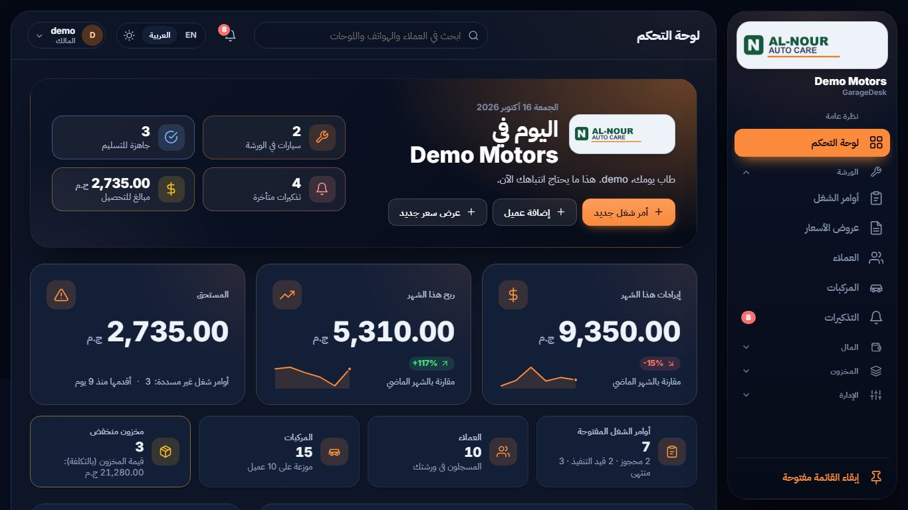
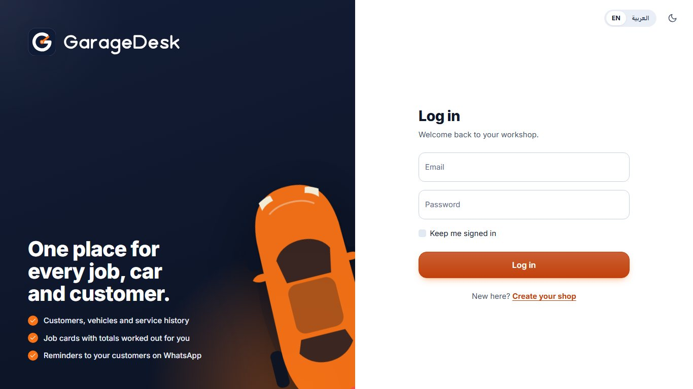
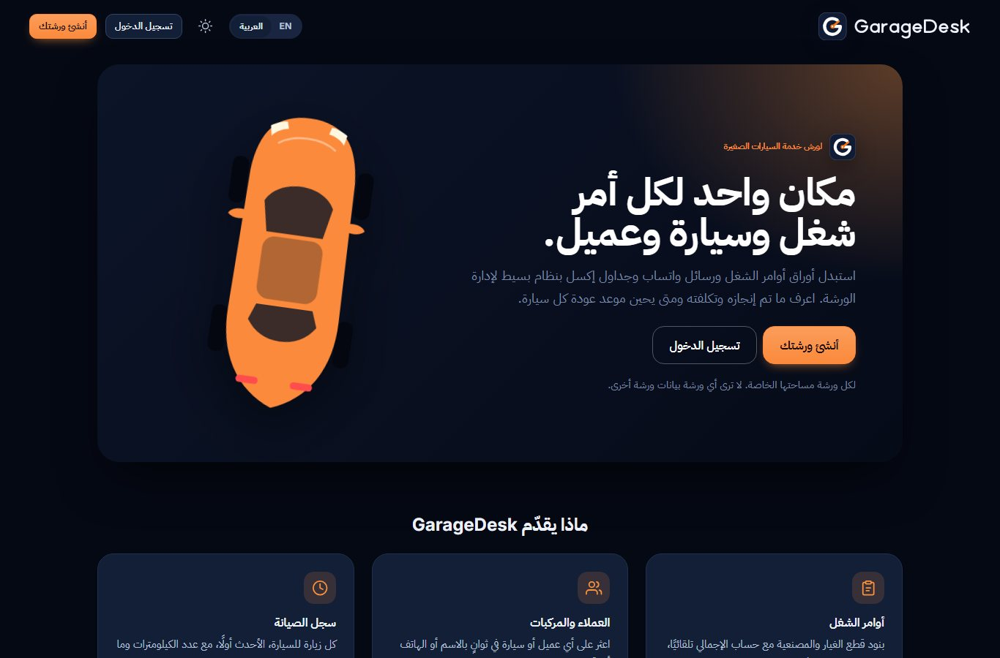
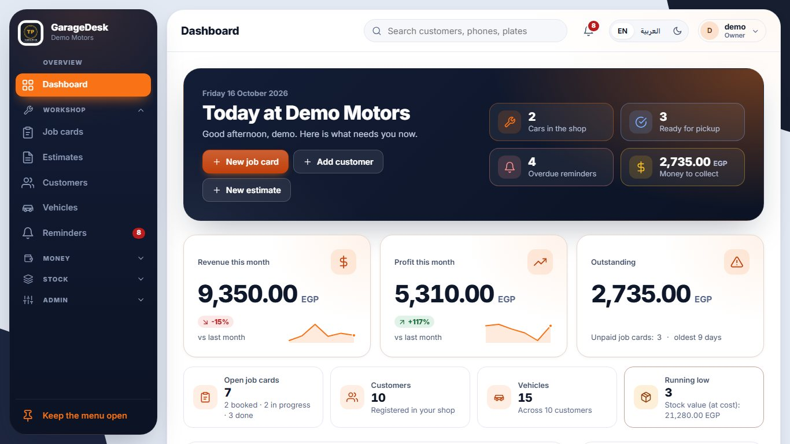
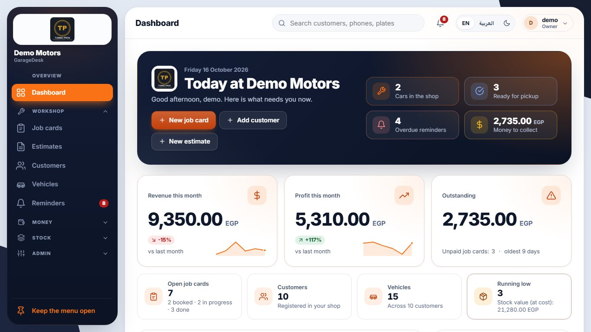
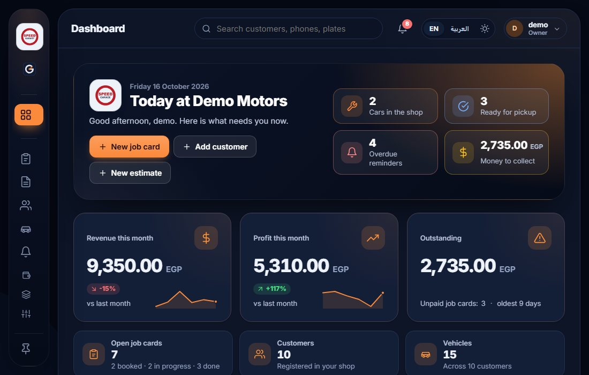
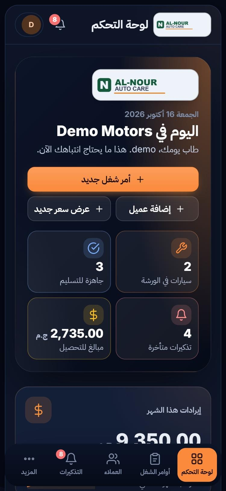
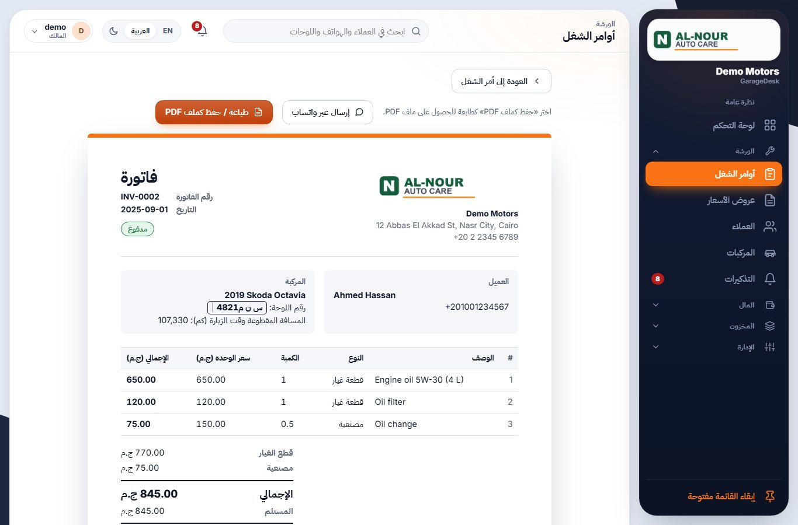
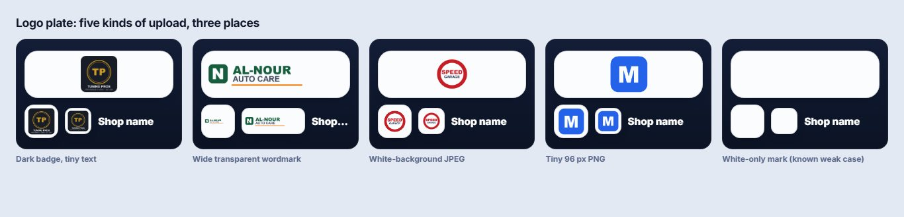
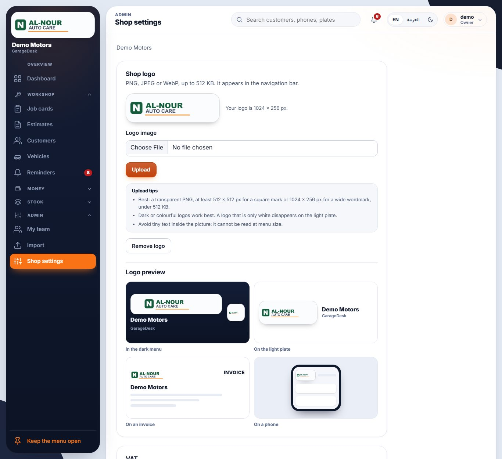

# GarageDesk brand

Branch `brand-logo`. Two jobs: make a **shop's own logo** clear in the app (part A) and give **GarageDesk itself** a
modern mark (part B). Presentation only: no business rule, role policy or tenant rule changed.

## B. The GarageDesk mark

### Three concepts (see `docs/brand/concepts/index.html`)

| | Idea | Verdict |
|---|---|---|
| **A. Gauge G** | A "G" drawn as the dial of a gauge, with an orange needle sweeping into the opening of the letter | **Chosen** |
| B. Bay door | An arched workshop door with slats and an orange threshold | Rejected: reads as a burger icon at 16 px, and says "garage" but not "desk" or "workshop manager" |
| C. Wrench ring | A ring with an open jaw like a spanner head, dark bar as the tool | Rejected: the bar reads as a battery, and a ring plus a tool is the generic clip-art we wanted to leave |

Why A: it is a letter (G, the initial) and a dashboard instrument (a workshop manager shows *state*: what is in, what
is due), and a car owner reads a gauge instantly. It is three simple strokes (arc, needle, hub), so it survives at 16 px
and at 512 px, and the orange needle gives the brand one memorable gesture. The earlier mark was the stock wrench glyph.

### Construction

Everything lives on a 64 x 64 grid.

* **Tile**: rounded square, radius 17, navy `#101b36`, with a 1 px inner edge (white at 16 percent) so it holds on the dark rail.
* **G**: arc of radius 20 around (32, 32), stroke 8, round caps, open on the upper right (starts at 44,16) and ending in a short bar at 3 o'clock.
* **Needle**: stroke 5, from the hub ring toward the opening (35.1,29.5 to 48,19). **Hub**: ring of radius 3.6, stroke 3.2, left open.
* Inside the tile the glyph is scaled to 0.9 (icons use 0.92). Bare (no tile) it is drawn at full size.
* **Wordmark**: hand-drawn monoline "GarageDesk", stroke 11 on a 72-unit cap height, round caps and joins, outlined (no font needed, always Latin, also in Arabic pages). The tail of the *g* hangs below the baseline.
* **Lockup**: mark height 64, wordmark cap height 26 centred on the mark, gap 16. Stacked: mark above, wordmark centred under it.

### Clear space and minimum size

* Keep a margin of **a quarter of the mark's height** free on all sides (a lockup too).
* Minimum: mark **16 px** (on screen) or 6 mm (print); horizontal lockup **96 px** wide (the wordmark's capitals are then 8 px tall); stacked lockup 72 px wide. Below that use the mark alone.
* A logo never mirrors: in right-to-left pages `.brand-lockup` is `direction: ltr`, mark first, Latin wordmark after.

### Colour

| Token | Value | Use |
|---|---|---|
| Tile navy | `#101b36` | the tile; matches the PWA splash `background_color` |
| Ink | `#0b1324` | wordmark and bare G on light, `theme_color`, the rail |
| White | `#ffffff` | the G on the tile, wordmark on dark |
| Needle orange | `#f97316` | the needle and hub, nothing else |

All parts are CSS variables (`--gd-tile`, `--gd-edge`, `--gd-arc`, `--gd-needle`, `--gd-word`), so light and dark
pages restyle the same markup. **A shop's accent may tint the needle and nothing else** (`--gd-needle: var(--accent)`):
only in signed-in chrome where the shop's own colour already shows (the rail when a shop has no logo, the phone header).
Login, landing, tab icons, PWA icons and customer pages keep GarageDesk orange.

### Do and don't

* Do use the full-colour tile on any background; use `-bare` (dark ink) on light and `-bare-light` on dark when there is no room for the tile.
* Do use `garagedesk-mark-mono.svg` / `garagedesk-lockup-mono.svg` (one colour, `currentColor`) for stamps and one-colour print.
* Don't recolour the tile or the G, don't put the needle in another colour on the login, landing or icons, don't rotate, outline, shadow-stack or stretch the mark.
* Don't set the wordmark in a font; use the supplied paths. Don't translate it. Don't add an Arabic tagline to the lockup (none was designed; Arabic copy sits beside it in the page).

### Where it appears

Login and register panel (large lockup), landing header, hero eyebrow and footer, the public header of Join and other
public pages, the rail and phone header when a shop has no logo, the app footer, the offline page (inlined), the
browser tab (SVG favicon, `favicon.ico`, 32 px PNG), the iOS home icon and the PWA icons. Customer share pages
(`/s/...`) get the tab icon only: no manifest, no service worker, no extra branding on a shop's page.

## A. A shop's own logo

A logo upload can be anything: a transparent mark, a dark badge, a white-background JPEG, a wide wordmark. It is shown
on a **plate**: a soft light tile (`#fbfcfe`, `#eef2f9` in dark theme) with a quiet inner ring and a shadow.

| Before (wrench tile, shop logo in a tiny white square) | After (logo plate, shop name, GarageDesk as the small line) |
|---|---|
|  |  |

The sample badge has tiny text inside the picture; that stays unreadable in any menu, which is why the upload tips say so.
Icon-only rail and phone header:

| Rule | Why |
|---|---|
| `object-fit: contain`, padding 10 percent of the plate height | never cropped or squashed, always a little air |
| `mix-blend-mode: multiply` on the image | the white box of a white-background JPEG melts into the plate |
| Light plate in both themes | dark and transparent-with-colour logos read on it; it looks like a bright tile on the dark rail |
| Radius 28 percent of height, 1 px ring, soft shadow | modern tile look that matches the rail |
| Rail: 3.2 rem square when icon-only, full rail width and 4.5 rem tall when open; the top of the rail has a fixed height | the logo is clear, and the menu never jumps when the rail opens |
| Shop name under the plate, `GarageDesk` as the small second line | the owner reads his own name first; the product stays present |
| Invoice and estimate: no plate, logo up to 64 x 22 mm, contain, multiply | a plate would print as a grey frame |

Also used on the phone header, the dashboard hero ("Today at ..."), the customer share pages, onboarding and Shop
settings. All of them reuse the same `/shop/logo?v=...` URL (one request).

**Why no owner-selectable background (Auto / Light / Dark / None)?** It would need a column, a migration and a value
carried in the login cookie (the rail reads the logo from claims), for a case that is rare: a logo that is only white.
The light plate handles every other kind of upload, and Shop settings now shows the logo in the dark menu, on the plate,
on an invoice and on a phone, with tips, so an owner sees a white-only logo disappear and swaps the file. No migration was added.

**Shop settings** also reads the pixel size from the file header (`ImageSize`: PNG IHDR, JPEG SOF, WebP VP8/VP8L/VP8X, no
package, never throws) and shows a gentle hint under 256 px on the short side. An upload is never blocked.

## Files

`src/GarageDesk.Web/wwwroot/brand/` (vector, 0.6 to 2.1 KB each): `garagedesk-mark.svg` (tile), `-mark-bare.svg`
(dark ink), `-mark-bare-light.svg`, `-mark-mono.svg`, `-lockup.svg` (dark word), `-lockup-light.svg` (white word),
`-lockup-stacked.svg`, `-lockup-stacked-light.svg`, `-lockup-mono.svg`.

`wwwroot/icons/`: `icon.svg` (favicon, 0.7 KB), `icon-maskable.svg`, `favicon-32.png` (1.5 KB), `apple-touch-icon.png`
180 (5.5 KB), `icon-192.png` (9.8 KB), `icon-512.png` (27.9 KB), `icon-maskable-512.png` (16.1 KB; the mark's outer radius
is 24 x 0.92 = 22 of 64 units, inside the 25.6 safe zone). `wwwroot/favicon.ico` (4.5 KB) packs 16, 32 and 48 px PNGs.

In the app: `_BrandMark`, `_BrandWord`, `_BrandLockup` (inline SVG, CSS variables) and `_ShopLogo` (the plate) in
`Pages/Shared`; styles in the `brand-logo` section of `site.css`. Overview sheet: `docs/brand/index.html`.

The PNG icons were rendered from the SVGs with headless Chrome (no package). The service worker cache is now
`gd-static-v2` so phones drop the old icons; `PwaTests` and `BrandLogoTests` check that every precached file exists.
