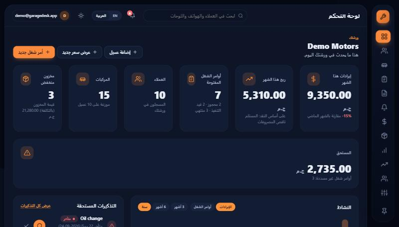
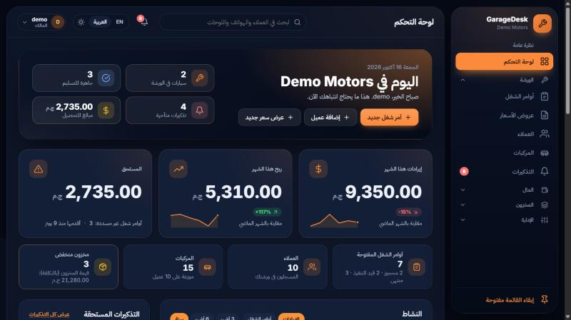
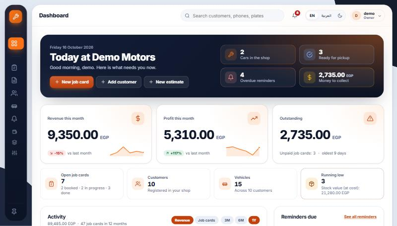
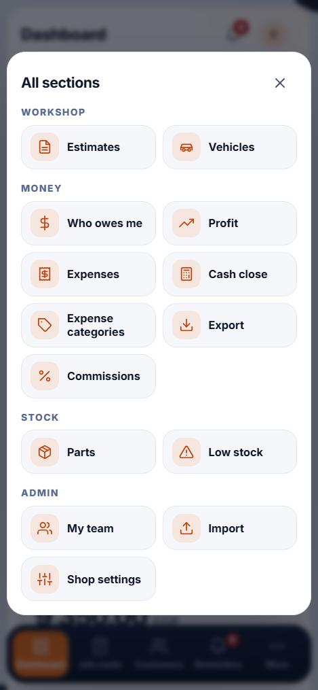

# GarageDesk design system

How the UI is put together, and why. Everything lives in `src/GarageDesk.Web/wwwroot/css/site.css` (one file,
no build step) plus a little vanilla JavaScript in `wwwroot/js/site.js`.

## The idea

A mechanic's bench, not a SaaS template.

- **Chrome is dark navy, like a tool chest.** The floating rail and the hero cards are the only dark surfaces in
  light mode, so the eye goes to the navigation and to the one thing that matters on a page.
- **One strong accent: safety orange.** It is used for the active nav item, primary buttons, the chart line and the
  car. Everything else is neutral, so orange always means "this".
- **A big calm white sheet** on a tinted backdrop, very rounded cards (16-30 px) and soft shadows. Whitespace
  does the separating; borders are quiet.
- **Distinctly "garage":** a car silhouette we drew ourselves (top-down, `_CarSilhouette.cshtml`), licence plates
  as real UI elements, kilometres and service intervals instead of generic "metrics".

## Tokens

All colour, radius, shadow, spacing and motion values are CSS variables at the top of `site.css`.

| Group | Examples |
|---|---|
| Brand | `--accent`, `--accent-strong` (text/buttons, AA contrast), `--accent-soft`, `--ink`, `--ink-2` |
| Surfaces | `--backdrop`, `--sheet`, `--surface`, `--surface-2`, `--surface-3`, `--line` |
| Text | `--text`, `--text-2`, `--text-3` |
| State | `--ok`, `--warn`, `--bad`, `--info` and their `-soft` backgrounds |
| Shape | `--r-xs` ... `--r-xl`, `--r-pill` |
| Depth | `--sh-1`, `--sh-2`, `--sh-3`, `--ring` (focus) |
| Motion | `--ease`, `--dur-1/2/3` |

Light and dark are two palettes of the same tokens (`[data-bs-theme="dark"]`). Dark is deep navy, not black.
Bootstrap's own variables are mapped onto the tokens, so its grid, forms and dropdowns follow the theme.

### Per-shop accent

A shop picks one of six presets (orange, blue, green, red, purple, teal) in **Shop settings**. It is stored in
`Shop.AccentColor`, carried in the login cookie as a claim and applied as `<html data-accent="...">`, which
re-points the accent tokens. Only names from `Accents.Presets` are ever written into the page.

## Components

App shell (floating rail, top bar, bottom tab bar on phones) · stat cards · activity chart (inline SVG, drawn in
`site.js`) · timeline · status tiles with meters · vehicle hero · data tables (sticky header, avatars, chips) ·
pager · segmented control · toasts · confirm dialog · empty states · split-screen auth pages.

## Behaviour rules

- **RTL:** logical properties only (`inline-start/end`, `margin-inline`, ...). A test fails if a physical
  `left`/`right` property sneaks into the stylesheet. Phone numbers, VINs and amounts are isolated `ltr`.
- **Motion:** hover lifts, the chart draw-in and toast slide-ins are all switched off under
  `prefers-reduced-motion`.
- **Accessibility:** visible focus ring on everything, `aria-current` on navigation, an accessible data table
  behind the chart, keyboard arrows move the chart's highlighted month, toasts use `aria-live`.
- **No JavaScript?** Pages still work: forms post, links link, server messages stay visible in place, and the
  chart's numbers are in the table.
- **Responsive:** designed down to 360 px; the rail becomes a bottom tab bar below 768 px.

## Fonts

Self-hosted, SIL OFL, in `wwwroot/fonts/` (licence text and sources in `NOTICE.txt` next to the files):
**Inter** (variable weight, Latin subset, 48 KB) for English text and for every digit, and **IBM Plex Sans Arabic**
(Arabic subset, weights 400/500/600/700, about 44 KB each) for Arabic letters. Total 226 KB. The Plex files only cover
the Arabic range, so numbers in an Arabic page still come from Inter and look the same in both languages. The system
stack (`Segoe UI`, `system-ui`...) stays behind them as the fallback, `font-display: swap` avoids invisible text, and
the service worker caches `/fonts/` like the other static files. `--font-sans` and `--font-ar` are the only switch.

## Screenshots

See `docs/screenshots/`.

## v2 design notes (branch `ui-polish-v2`)

The owner said the UI "is still wrong somewhere, needs categories on the panel so it is easy to navigate, and must
catch the eyes of business owners". Presentation and navigation only: no business rule, policy or data rule changed.

| Before (flat list, equal cards, "ج.م" on its own line) | After (Arabic, dark, rail open) |
|---|---|
|  |  |

### What was wrong (found on real renders)

1. **One flat rail of 12 links**, no grouping; on a 768 px laptop the last items fell below the fold.
2. **Money cards had no hierarchy.** Six equal cards; the currency wrapped to its own line under the number; sub-lines
   had uneven heights. Revenue, profit and what is owed looked the same as "customers: 10".
3. **No "today".** Nothing said what needs attention now.
4. **Low-contrast secondary text** (the muted greys were about 3.5:1 on white), flat cards, empty areas.
5. **Licence plates in the wrong order.** A plate typed digits first ("9251قسن") made the whole chip right-to-left, so
   the number landed on the wrong side of the letters. Egyptian plates read letters, then the number.
6. **The top bar was crowded**: search, bell, language, theme and a long email, all loose.
7. **A page-wide horizontal scroll on phones.** The chart's tooltip, centred on the newest month, hung 27 px outside
   the card at 375 px and widened the whole page.
8. **Broken stylesheet.** `.figure-negative` was missing its closing brace in `site.css`, so the browser nested the
   last ~340 lines (setup wizard, install banner, and the whole public landing page) inside it as
   `.figure-negative .landing-hero` and so on: none of that CSS ever matched. Fixed; the landing page now renders as designed.

### Navigation: the IA decision

| Section | Entries | Who |
|---|---|---|
| Overview | Dashboard | owner, cashier |
| Workshop | Job cards, Estimates, Customers, Vehicles, Reminders (badge) | owner, cashier. A technician sees only this section, with "My jobs" |
| Money | Who owes me; owner only: Profit, Expenses, Cash close, Expense categories, Export, Commissions | owner (all), cashier (Who owes me) |
| Stock | Parts, Low stock | owner, cashier |
| Admin | My team, Import, Shop settings | owner |

Why these five: they follow the owner's day. *Workshop* is what happens to cars; *Money* is what happens to cash
(the front desk's "who owes me" lives next to the owner's reports because it is the same question); *Stock* is parts;
*Admin* is set-up you rarely touch. Job cards come first in Workshop because they are the unit of work. Rules:

* **Roles are exactly as before.** `NavBuilder` mirrors the page policies; a test requests every link of every role and
  expects 200. Sections with nothing to show are not created at all. A technician's single section has no toggle.
* **Collapsible.** Click a header to fold or open it; the choice is remembered per browser (`localStorage`, wrapped in
  try/catch). The section holding the current page is always open. A small menu (the cashier's) opens everything; the
  owner's starts with Overview and Workshop open. Without JavaScript every section is open.
* **Narrow (icon-only) rail.** An open section shows as a thin divider, a closed one as its own icon, so the rail has the
  same height whether it is narrow or open (no jumping when you hover it).
* **Scrolls by itself.** Only the middle of the rail scrolls (a thin scrollbar); the brand and the pin button stay put.
* **RTL.** Logical properties only; the rail is on the right in Arabic with no extra CSS.
* **Keyboard.** Headers are real buttons with `aria-expanded` / `aria-controls`; focus rings are inset so the scroll
  area does not clip them; focusing anything in the rail opens it.
* **Phone.** The bottom bar keeps Dashboard, Job cards, Customers and Reminders (with its badge); **More** opens a
  sheet with every other section, built from the same data, so the two can never disagree. Without JavaScript the
  "More" link jumps to the sheet (`:target`).
* **Top bar.** Section name above the page title; language and theme share one small pill; the user button shows the
  name and role (the email moved into the menu).

### The dashboard

* **Hero "Today at <shop>"**: date, greeting by the shop's clock, and four chips, each a link and each a real count:
  cars in the shop (`/Jobs?status=InProgress`), ready for pickup (`/Jobs?status=Done`), overdue reminders (`/Reminders`),
  money to collect (`/Receivables`). A zero is shown calm and muted.
* **Money row (owner):** revenue, profit and outstanding as big numbers with the currency on the same baseline, a
  "vs last month" badge (shown only when last month has a figure to compare with) and a small trend line drawn from the
  last six real months (not drawn when every month is zero). Outstanding shows how many customers owe and how old the
  oldest debt is. **Counts row:** open job cards, customers, vehicles, running low, quieter on purpose.
* **Cashier:** the hero, Outstanding and Open job cards, the counts; no revenue, profit, cost or chart (unchanged).
* The activity chart is taller and has a one-line summary above it.

### Visual system

* Layered surfaces and a soft top light in dark mode; gradients on the rail, hero and money cards are built from
  `--accent` / `--accent-rgb`, so all six shop accents work (checked with teal).
* A type scale (`--fs-xs` ... `--fs-2xl`), 8 pt spacing, one icon size per component, primary buttons with a light
  top gradient, 44 px form controls, calmer table hover, empty states with a soft accent glow and one button.
* `prefers-reduced-motion` switches off every transition and animation (unchanged global rule).

### Contrast checks (WCAG 2.x, measured in the browser from the computed token values)

| Pair | Light | Dark |
|---|---|---|
| body text on page surface | 17.9 | 14.8 |
| `--text-2` (secondary) on surface | 8.1 | 9.2 |
| `--text-3` (muted) on surface / surface-2 / surface-3 | 5.6 / 5.3 / 4.8 | 6.4 / 7.2 / 5.9 |
| accent text on page | 5.2 | 8.0 |
| button label on accent | 5.2 | 8.1 |
| rail muted text on the navy | 6.4 | 5.7 |
| ok / warn / bad / info on their soft badge | 6.2 / 6.3 / 5.6 / 5.8 | 7.1 / 7.3 / 4.9 / 5.7 |

Before: `--text-3` was about 3.5:1 on white and `--ok` / `--warn` badges were 4.3 and 4.4. They were darkened
(`--text-3` #59678a, `--ok` #166534, `--warn` #92400e, green accent #166534). Everything, including the five other shop accents (accent text on its soft tint and the button label), is at or above 4.5:1; the dark purple button label was 4.4 and was darkened too.

### Licence plates

`PlateFormat` splits a plate with Arabic letters into one letter group and one digit group, isolates each in its own
direction and always draws **letters first in the reading direction of the page** (right in Arabic, left in English),
with a thin divider. The stored plate and the search key are untouched. A Latin plate, or anything that is not exactly
one letter group plus one digit group, is shown as typed.
